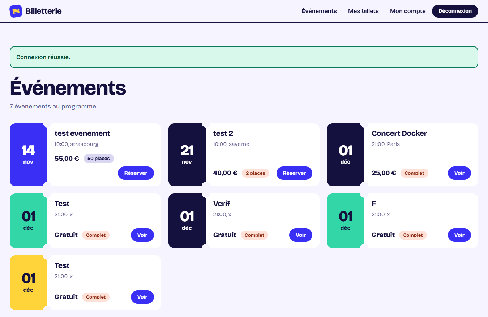
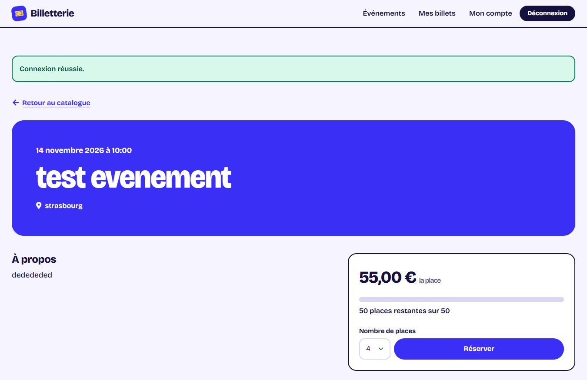
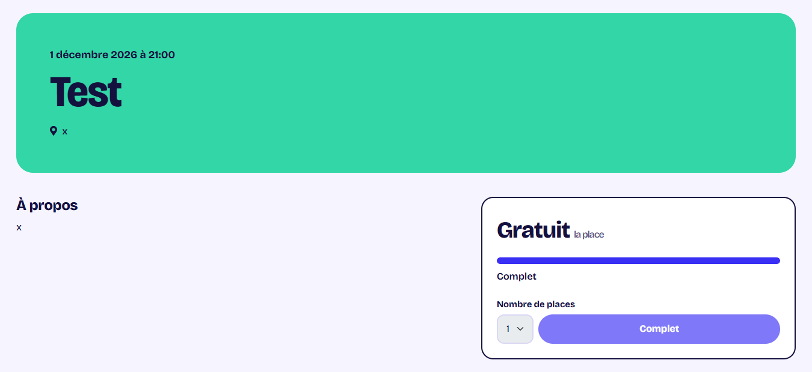
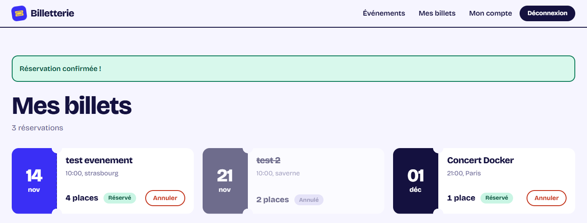
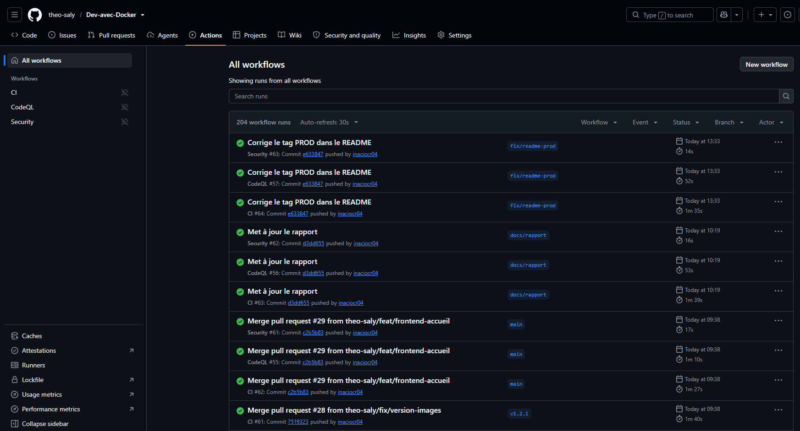

# Rapport de projet – Dév avec Docker

**Billetterie d'événements en micro-services**
**Auteurs :** Inacio Rodrigues, Théo Saly
Dépôt : https://github.com/theo-saly/Dev-avec-Docker – code rendu : branche `main` – dernière version publiée : tag `v1.2.1`

Pour ce projet, nous avons choisi de faire une billetterie d'événements. Un administrateur crée des événements (concerts, salons…) avec un nombre de places limité, et les utilisateurs connectés peuvent réserver des billets tant qu'il reste de la place.


*Figure 1 : la page d'accueil de l'application*


## Lancer le projet

```bash
git clone https://github.com/theo-saly/Dev-avec-Docker.git && cd Dev-avec-Docker
cp .env.example .env          # puis remplacer chaque valeur "remplacer-..."
docker compose --env-file env/test.env --env-file .env up -d --build --wait
```

L'application est ensuite accessible sur http://localhost:8080. Le compte administrateur est celui renseigné dans le `.env` (`ADMIN_EMAIL` / `ADMIN_PASSWORD`).

## 1. Architecture logicielle

L'application est découpée en six conteneurs applicatifs, plus MySQL et Redis :

```
Navigateur ──► reverse-proxy :8080 (nginx, seul port exposé)
                 ├── /                → frontend (React, fichiers statiques)
                 ├── /api/auth/       → auth-service   (PHP)  ── MySQL base auth
                 ├── /api/events      → event-service  (Node) ── MySQL base events
                 └── /api/tickets     → ticket-service (Node) ── MySQL base tickets
ticket-service ── HTTP ──► event-service (existence et capacité de l'événement)
event-service / ticket-service ── Redis Streams ──► notification-service (Node)
```

| Service | Langage | Rôle |
| --- | --- | --- |
| frontend | React / nginx | L'interface, avec une garde de routes `public` / `auth` / `admin` |
| reverse-proxy | nginx | Le seul point d'entrée, qui redirige vers le bon service |
| auth-service | PHP 8.3 / Symfony 7.4 | Les comptes, les rôles et la création des tokens JWT |
| event-service | Node 22 / Express | Le catalogue : tout le monde peut le lire une fois connecté, seul l'admin le modifie |
| ticket-service | Node 22 / Express | Les réservations, avec le contrôle du nombre de places |
| notification-service | Node 22 | Reçoit les événements de Redis et les journalise (envoi de mail possible) |

Le frontend ne garde aucune session côté serveur. À la connexion, auth-service renvoie un token JWT qui contient l'identifiant, l'email et le rôle de l'utilisateur. Chaque backend vérifie ce token lui-même avec un secret partagé, donc aucun service n'a besoin d'appeler auth-service à chaque requête. Pour se déconnecter, le frontend supprime simplement le token.

Nous avons donné à chaque service sa propre base de données, sans clé étrangère entre elles. Chaque service reste ainsi indépendant, et quand ticket-service a besoin d'une information sur un événement, il la demande à event-service par son API.

Les droits sont vérifiés par les backends eux-mêmes : une requête sans token reçoit une erreur 401, et une requête sans les droits nécessaires une erreur 403. Le frontend, lui, se contente de cacher les pages et les boutons auxquels l'utilisateur n'a pas accès.

Les règles de gestion sont les suivantes :
- l'inscription crée toujours un compte standard, même si quelqu'un essaie d'envoyer `"role": "admin"` ;
- un admin peut supprimer des comptes standard, mais pas un autre admin ;
- le dernier admin ne peut pas supprimer son propre compte, sinon plus personne ne pourrait gérer le site ;
- une réservation est refusée (409) quand il n'y a plus assez de places. Le calcul se fait dans une transaction MySQL avec un verrou (`SELECT … FOR UPDATE`), pour que deux réservations simultanées ne dépassent pas la capacité.

Chaque backend a ses tests unitaires : 36 pour auth-service (PHPUnit), 17 pour event-service, 19 pour ticket-service et 4 pour notification-service (Jest).

### Parcours d'un utilisateur

Une fois connecté, l'utilisateur arrive sur le catalogue. Chaque carte affiche le prix de l'événement et le nombre de places restantes, ou « Complet » quand il n'y en a plus.



*Figure 2 : le catalogue des événements, vu par un utilisateur connecté*

Sur la fiche d'un événement, il choisit le nombre de places (jusqu'à 10 par réservation) puis réserve. Quand l'événement est complet, le bouton est désactivé. Même si quelqu'un contournait l'interface, ticket-service refuserait la réservation.



*Figure 3 : la fiche d'un événement avec des places disponibles*



*Figure 4 : un événement complet, la réservation n'est plus possible*

Ses réservations apparaissent ensuite dans « Mes billets », d'où il peut les annuler. Un billet annulé reste visible mais grisé, et ses places sont remises en vente.



*Figure 5 : la page « Mes billets » juste après une réservation, avec un billet annulé*

## 2. Dockerfiles et docker-compose

### Les Dockerfiles

Chaque service a son propre Dockerfile. Au départ, les trois services Node partageaient un seul Dockerfile paramétré, mais nous l'avons séparé : le sujet insiste sur l'indépendance de chaque micro-service, et un fichier par service est plus simple à lire.

Nous avons suivi les pratiques vues en cours :
- un build multi-stage avec un stage `AS builder` et un stage `AS production`. Les outils qui servent uniquement à construire (Composer, TypeScript, Vite) ne se retrouvent pas dans l'image finale ;
- les fichiers de dépendances (`package.json`, `composer.lock`) sont copiés avant le code. Comme ça, quand on modifie seulement le code, Docker réutilise son cache et ne réinstalle pas tout. On utilise `npm ci` et `composer install`, qui respectent exactement les versions des lockfiles ;
- des versions d'images précises (`node:22.23.4-alpine`, `mysql:8.4.13`…) plutôt que des tags qui changent dans le temps ;
- des métadonnées avec `LABEL` (auteur, description, version). La version n'est pas écrite à la main : la CI la passe au build avec `ARG VERSION`, donc le label d'une image correspond toujours à son tag ;
- aucun conteneur ne tourne en root. C'est pour ça que les deux nginx écoutent sur le port 8080 : un utilisateur sans privilèges ne peut pas ouvrir un port inférieur à 1024 ;
- des images Alpine pour qu'elles restent légères, avec un `apk upgrade` au build pour appliquer les derniers correctifs de sécurité. Nous avons aussi retiré npm des images Node finales, car il n'est plus utile une fois les dépendances installées ;
- un `HEALTHCHECK` dans chaque image, aucun secret dans les images, et un `.dockerignore` pour ne pas envoyer de fichiers inutiles au build.

Pour le service PHP, nous avons choisi FrankenPHP. Le serveur intégré `php -S` est réservé au développement, et le couple nginx + php-fpm demande deux processus. FrankenPHP est prévu pour la production et tient dans un seul processus, ce qui respecte l'idée d'une application par conteneur.

Le scanner Trivy ne trouve aucune faille critique sur nos 6 images, qui font entre 64 et 198 Mo.

### Le docker-compose

Toute l'application (8 conteneurs) se lance avec une seule commande.

Seul le reverse-proxy publie un port vers l'extérieur. Les backends, MySQL et Redis sont sur un réseau marqué `internal` : on ne peut pas les joindre depuis la machine, et eux ne peuvent pas sortir sur Internet. La seule exception est notification-service, qui a accès à un réseau `egress` pour pouvoir envoyer des mails.

Nous utilisons une seule instance MySQL, mais avec une base et un utilisateur différents pour chaque service. Par exemple, l'utilisateur de event-service n'a aucun droit sur la base des comptes.

Les services démarrent dans le bon ordre grâce à `depends_on` avec `condition: service_healthy` : un service attend que MySQL soit vraiment prêt avant de démarrer, et ses migrations se lancent au démarrage. Chaque conteneur a aussi des limites de CPU et de mémoire. Nous les avons ajustées après mesure : MySQL utilisait 476 Mo sur les 512 Mo autorisés, nous sommes donc passés à 1 Go.

Pour les environnements, les mots de passe restent dans le fichier `.env`, qui n'est jamais commité. Les réglages propres à chaque environnement sont dans `env/test.env`, `env/uat.env` et `env/prod.env` :

| | TEST | UAT | PROD |
| --- | --- | --- | --- |
| Images | construites en local (`build:`) | publiées par la CI, tag `sha-<commit>` | publiées par la CI, tag `v1.2.1` |
| Port | 8080 | 8081 | 80 |
| Redémarrage automatique | non | `unless-stopped` | `always` |
| Backends | 0,5 CPU / 256 Mo | 0,5 CPU / 256 Mo | 1 CPU / 512 Mo |
| MySQL | 1 Go | 1 Go | 2 Go |

## 3. Git et CI/CD

Nous avons tout mis dans un seul dépôt GitHub. Comme certains changements touchent plusieurs services à la fois (le format du token, les routes), c'était plus simple de les livrer ensemble. Chacun travaillait sur sa propre branche, et on fusionnait dans `main` par pull request. Les branches ont un préfixe selon leur contenu : `feat/` pour une fonctionnalité, `fix/` pour une correction, `docs/` pour la documentation. Quand une version était prête, on posait un tag (`v1.0.0`, puis `v1.1.0`, `v1.2.0` et `v1.2.1`) : le deuxième chiffre augmente quand on ajoute quelque chose, le troisième pour une correction.

Le pipeline (`ci.yml`) se lance à chaque push, sur n'importe quelle branche, et à chaque tag de version (`v*`). Il enchaîne quatre étapes :
1. les tests unitaires et le lint (Jest pour les services Node, PHPUnit pour auth-service) ;
2. la construction de l'image de chaque service (6 images) ;
3. un scan de sécurité avec Trivy, qui bloque si une faille critique est trouvée. Une image vulnérable n'est donc jamais publiée ;
4. la publication des images sur le registre GitHub (GHCR).

Si une étape échoue, la suite ne se lance pas : la construction des images attend que tous les tests soient passés. Chaque image reçoit un identifiant unique : `sha-<commit>` pour un commit, ou le nom du tag (par exemple `v1.2.1`) pour une version.



*Figure 6 : l'historique des exécutions sur GitHub Actions. Chaque push lance les trois workflows (CI, CodeQL et Security), sur toutes les branches comme sur le tag `v1.2.1`.*


La mise en place n'a demandé aucun secret à configurer : la CI se connecte au registre GitHub avec le jeton fourni automatiquement à chaque exécution (`GITHUB_TOKEN`), auquel on donne seulement le droit de publier des paquets. Les six images sont construites en parallèle grâce à une matrice (un job par service), et leurs tags sont calculés par l'action `docker/metadata-action`. Les images sont publiques, donc les environnements UAT et PROD les récupèrent avec un simple `docker compose pull`.

En plus de ce qui était demandé, nous avons ajouté gitleaks (pour détecter un secret commité par erreur), `npm audit`, une vérification du docker-compose et une analyse CodeQL.

## 4. Gestion de projet

Nous avons organisé le travail avec un [tableau Trello](https://trello.com/invite/b/6ae079b00de9fcfb33c24de8/ATTI0c62284b5440f57ef76216b30944b929ECFEAB09/dev-avec-docker) en trois colonnes (*À faire*, *En cours*, *Terminé*). Chaque livrable avait sa carte, avec une checklist, une étiquette de domaine (Backend, Frontend, Infra, CI/CD, Sécurité, Rapport, Démo), un responsable et une échéance.

### Répartition des tâches

| | Inacio Rodrigues | Théo Saly |
| --- | --- | --- |
| Backends | auth-service (PHP / Symfony) | event-service, ticket-service, notification-service (Node) |
| Frontend et accès | | frontend React, reverse-proxy |
| Docker | Dockerfiles, docker-compose, environnements TEST / UAT / PROD | |
| CI/CD | | pipeline GitHub Actions, CodeQL, gitleaks |
| Rapport | Dockerfiles, compose, gestion de projet | architecture, CI/CD |

La première chose que nous avons faite, c'est nous mettre d'accord sur le contrat entre les services : le contenu du token, les codes d'erreur et les routes. Une fois ça fixé, chacun pouvait avancer de son côté sans attendre l'autre.

### Planning

| Date | Livrable |
| --- | --- |
| 22/10 | Contrat d'interface entre les services fixé |
| 24/10 | Services Node, reverse-proxy, frontend et pipeline CI (Théo) |
| 26/10 | auth-service PHP, Dockerfiles, compose, intégration, README et rapport (Inacio) |
| 26/10 | Fusion dans `main`, tag `v1.0.0` |
| 27-28/10 | Tests de bout en bout, captures de la CI, rapport |
| 28/10 | Un Dockerfile par service, selon les pratiques du cours, tag `v1.1.0` |
| 28/10 | Nouvelle page d'accueil et footer commun |
| 29/10 | Version des images injectée par la CI, tag `v1.2.1` |
| 29/10 | Refonte de l'interface (toutes les pages) et accessibilité |
| 30/10 | Démonstration |

## 5. Rétrospective

Nous sommes partis d'un projet existant de gestion de tâches, en pensant gagner du temps. En pratique, on a passé beaucoup de temps à supprimer du code avant de pouvoir en écrire : une base SQLite, deux versions de l'API, une API gateway… Avec le recul, partir d'un projet vierge aurait sûrement été plus rapide.

En reprenant ce code, nous avons aussi trouvé une vraie faille : aucun service ne vérifiait le token, et il suffisait de changer un paramètre dans l'URL pour lire les données de quelqu'un d'autre. Nous avons ajouté une vérification du token dans chaque service, et l'identité de l'utilisateur est maintenant lue uniquement dans le token.

L'ancien service d'authentification gardait les comptes en mémoire, ils disparaissaient donc à chaque redémarrage, et il n'y avait pas de rôles. Nous l'avons réécrit en PHP avec une vraie base MySQL, ce qui nous a aussi apporté le deuxième langage demandé.

Nous avons aussi rencontré plusieurs problèmes avec Docker :

| Problème | Ce que nous avons fait |
| --- | --- |
| Des failles critiques bloquaient la CI (Trivy, `npm audit`) | Mise à jour des dépendances concernées, et suppression de npm dans les images finales |
| notification-service ne pouvait pas écrire ses logs dans son volume, parce qu'il ne tourne pas en root | Créer le dossier de logs dans l'image avec le bon propriétaire |
| MySQL était presque à sa limite de mémoire (476 Mo sur 512) | Passer la limite à 1 Go après l'avoir mesurée |
| Un seul Dockerfile pour les trois services Node, ce qui allait contre l'indépendance des micro-services | Un Dockerfile par service |
| Le label `version` des images était resté à `1.0.0` alors qu'on en était à la `v1.2.0` | Faire passer la version par la CI au moment du build (`ARG VERSION`), en plaçant ce bloc à la fin du Dockerfile pour ne pas casser le cache |

Il reste une limite que nous n'avons pas eu le temps de corriger. Comme chaque service a sa propre base, supprimer un événement ou un compte ne supprime pas les billets qui y sont liés. La solution serait que ticket-service écoute le message `event-deleted`, déjà publié sur Redis, pour annuler les billets concernés.

Nous savions déjà que Docker permet de lancer exactement la même application sur n'importe quelle machine, mais ce projet nous l'a fait vivre concrètement : une seule commande suffisait pour que nous ayons tous les deux la même application, avec les mêmes versions, sans rien installer d'autre. Si c'était à refaire, nous commencerions par là, en mettant en place le docker-compose avant même d'écrire le code des services.

Nous ajouterions aussi un test de bout en bout dans la CI, qui lance tout le docker-compose et vérifie qu'une réservation fonctionne. Nos tests unitaires vérifient chaque service séparément, mais rien ne contrôle automatiquement qu'ils fonctionnent ensemble. Enfin, la vérification du token est copiée dans event-service et ticket-service : nous la mettrions dans un module partagé pour ne pas avoir à corriger deux fois le même code.
